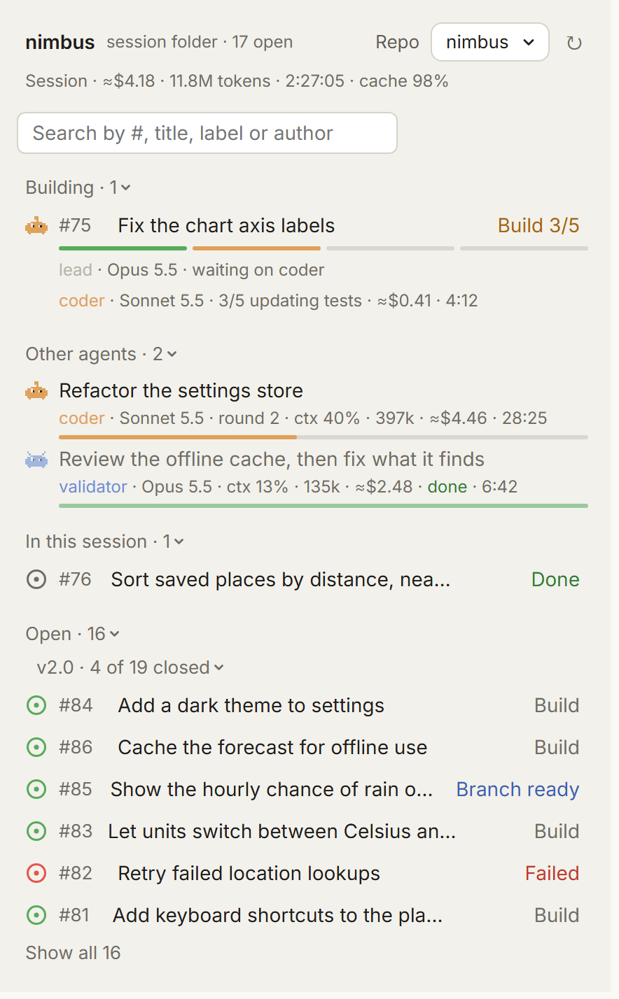
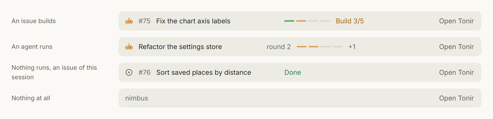
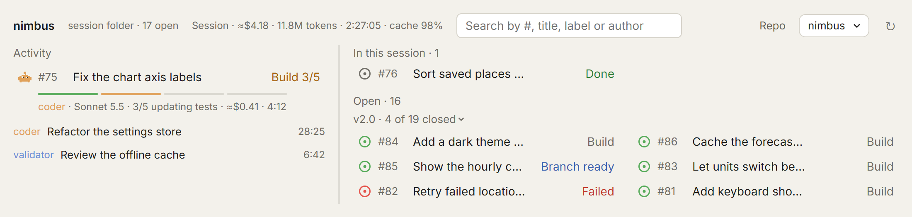

<p align="center">
  
</p>

<h1 align="center">Tonir</h1>

<p align="center">
  The GitHub issues of the repo you're working in, a one-press Build for each, and every agent of
  the session, in one pane beside the chat in the Claude desktop app.
</p>

<p align="center">
  <a href="LICENSE"></a>
</p>

<p align="center">
  <picture>
    <source srcset="media/pane-dark.png" media="(prefers-color-scheme: dark)">
    
  </picture>
</p>

> [!NOTE]
> Tonir is a Claude Code plugin built on the app's mod hooks, which are new and still change.
> A Claude Code update can break it before Tonir catches up. When something breaks or reads
> wrong, please [open an issue](https://github.com/RicardoSilveira23/tonir/issues).

## What it does

- **Issues of the repo you're in.** The pane follows the session: the session's folder when it
  is a repo, else the repo of the last file the session used, else every repo one level under
  the folder, or two levels where the folder between is not a repo itself (up to 40). Finding
  them reads only git and GitHub metadata. The repo picker pins one, and "All repos" lets go again. Issues are grouped by
  milestone, those the session talks about (`#12` in a prompt) come first, and a search narrows
  them by number, title, label or author.
- **Build.** One press on an issue starts a lead agent that works in a git worktree of its own:
  it writes the change with a coder agent, has a validator agent review it, and commits locally.
  It is told never to push or open a pull request. Only open issues whose author is the repo's
  owner, a member of the organisation that owns it, or a collaborator can be built, unless you
  choose otherwise, and only in repos your GitHub account can push to. At the press Tonir reads
  the issue again from GitHub and hands its title and body to the agents in their prompt; they
  are told to read nothing else of GitHub's for it, not its comments, linked issues or links.
- **Agents.** Each agent of the session is a row with a small sprite for its kind, a thin bar
  for its progress or context, and its model, tokens, cost and time. The session's own agent
  has a row too, Main, with its context, use and whether it is working or idle. A building
  issue shows its pipeline (ticket, build, check, review) and its crew under it.
- **A bar above the prompt**, when you turn it on: the pane's top item in one line, and an
  "Open Tonir" button.

<p align="center">
  <picture>
    <source srcset="media/bar-dark.png" media="(prefers-color-scheme: dark)">
    
  </picture>
</p>

Open it with `/tonir`, from the right-click menu, or from the bar. It opens by itself when an
agent starts after a quiet spell, unless you turn that off.

Docked above or below the chat, where the pane is wide and short, everything moves to one
header line, builds and agents sit in an Activity column, and the issues flow into as many
columns as fit:

<p align="center">
  <picture>
    <source srcset="media/docked-dark.png" media="(prefers-color-scheme: dark)">
    
  </picture>
</p>

## Installing

Tonir needs the Claude desktop app, [git](https://git-scm.com/), and the
[GitHub CLI](https://cli.github.com/) signed in (`gh auth login`).

```
claude plugin marketplace add RicardoSilveira23/tonir
claude plugin install tonir@tonir
```

New sessions load it; `/reload-plugins` loads it in one already open.

## Settings

Set in `/plugin`, or under `pluginConfigs["tonir@tonir"].options` in Claude Code's
`settings.json`:

| Setting | Values | What it does |
|---|---|---|
| `isolation` | `worktree` (default), `none` | Where a build works: a git worktree of its own, or the session's folder |
| `leadModel` | `opus` (default), `sonnet`, `haiku`, `fable`, `inherit` | The model of the build's lead agent |
| `coderAgent` | `coder` (default) | The agent type that writes the code; `general-purpose` when none exists |
| `validatorAgent` | `validator` (default) | The agent type that reviews it; `general-purpose` when none exists |
| `trustedAuthors` | `members` (default), `owner`, `anyone` | Whose issues can be built, by who opened them: `members` is the owner, the owning organisation's members and the repo's collaborators; `owner` is your own login |
| `blockedFolders` | folder names, comma-separated | Folders Tonir never reads, lists or builds in |
| `buildInstructions` | text | Extra rules added to every build lead's prompt |
| `autoOpenAgents` | `on-spawn` (default), `never` | Whether Tonir opens when an agent starts |
| `openBar` | `off` (default), `on` | The bar above the prompt |

## What it runs, what it sends

Tonir makes no network calls of its own. It runs:

- `git` in the repos it shows, to find a folder's repo, its `origin` remote, its branches and its
  default branch.
- `gh api` through your own `gh` sign-in, for the GitHub repository the `origin` remote names:
  `repos/<owner>/<name>/issues` to list open issues; and at a Build press, `repos/<owner>/<name>`
  (can your account push?), `repos/<owner>/<name>/issues/<n>` (the issue as it is now) and,
  with `trustedAuthors` set to `owner`, `user` (your login). GitHub is the only service this
  reaches.
- Agents in your Claude Code session, only when you press Build. A build's agents work in the
  repo with your session's permissions; read the prompt they get in `hooks/issues.tsx`. The
  worktree is made by Claude Code when it can isolate a plugin's agent; otherwise the lead is
  told to make one. Folders in `blockedFolders` are named to the agents as off limits.

It registers a `step` tool, and asks its own build agents, and the subagents they start, to
report their steps with it; other agents of the session are left as they are. It keeps its
state in Claude Code's plugin state and writes no files of its own.

## Building from source

The plugin is TypeScript the Claude Code engine loads as it is: there is no build step. To work
on it, clone the repo and add the clone as a marketplace:

```
claude plugin marketplace add <path to the clone>
claude plugin install tonir@tonir
```

`claude plugin test <path to the clone>` runs the tests, and `claude plugin validate` checks the
manifest. Before a push, `node scripts/check-exposure.mjs` checks the tracked files for account
ids, local paths and personal addresses.

## Issues and security

Tonir is a one-person project: bugs and ideas go in
[Issues](https://github.com/RicardoSilveira23/tonir/issues/new/choose), and pull requests are
open to collaborators only. [CONTRIBUTING.md](CONTRIBUTING.md) says more. Report a security
problem privately, as [SECURITY.md](SECURITY.md) says.

## Licence

Copyright 2026 Ricardo Silveira. Tonir is free software under the
[GNU General Public License v3.0 or later](LICENSE): you may use it, change it and share it,
and any copy you hand out, changed or not, stays under the same licence, with its source.
